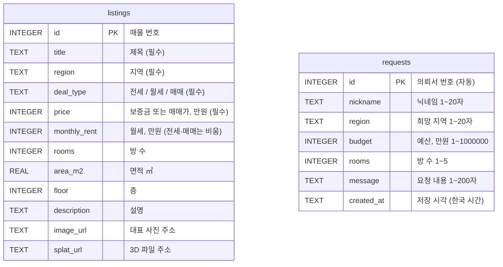
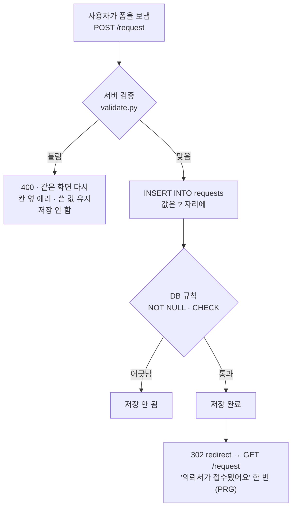

# DB 구조 — 집결 (jib-gyeol)

SQLite는 DB 전체가 파일 하나예요. 이 프로젝트의 DB 파일은 `jibgyeol.db`이고, 표는 `db.py`의 `init_db()`가 서버를 켤 때 만들어요.

## 한눈에 보기



두 표는 서로 연결되어 있지 않아요. 의뢰서의 `region`은 사용자가 직접 쓴 글자이고, 매물 표를 가리키지 않아요.

```
jibgyeol.db  (파일 하나 = DB 전체, 깃에 올리지 않음)
│
├─ listings   매물      ← data/listings.csv 에서 채움   (담당: 팀원 A)
│     읽기만 해요:  ① 홈 · ② 매물 보기 · ③ 매물 상세 · ⑤ 찜 목록
│
└─ requests   의뢰서    ← 사용자가 폼으로 남김          (담당: 팀원 B)
      쓰기 + 읽기:  ④ 의뢰서 남기기

세션 (DB 아님, 브라우저 쿠키)
└─ wish       찜한 매물 번호 목록  예: [1, 3]            (담당: PO)
```

## `requests` — 의뢰서 (담당: 팀원 B)

사용자가 `/request` 폼으로 남기는 표예요.

| 칸 | 종류 | DB 규칙 | 어디서 오나 | 예시 |
|---|---|---|---|---|
| `id` | INTEGER | 기본 키, 자동 번호 | DB가 매김 | `1` |
| `nickname` | TEXT | NOT NULL, 1~20자 | 폼 | `이사준비` |
| `region` | TEXT | NOT NULL, 1~20자 | 폼 | `마포구` |
| `budget` | INTEGER | NOT NULL, 숫자, 1 ~ 1,000,000 | 폼 (만원 단위) | `20000` |
| `rooms` | INTEGER | NOT NULL, 숫자, 1~5 | 폼 | `2` |
| `message` | TEXT | NOT NULL, 1~200자 | 폼 | `햇빛이 잘 드는 집이면 좋겠어요.` |
| `created_at` | TEXT | NOT NULL | 서버가 한국 시간으로 넣음 | `2026-11-11 15:30` |

- 실명 · 전화번호 · 이메일을 받는 칸은 없어요.
- 규칙은 두 겹이에요. 먼저 `validate.py`가 검사하고, 그걸 건너뛴 값이 와도 DB의 `CHECK`가 한 번 더 막아요.
- SQLite는 원래 숫자 칸에 글자를 넣어도 받아 줘요. 그래서 `budget` · `rooms`에는 "숫자여야 한다"는 규칙을 따로 걸었어요.

### 의뢰서가 저장되는 길



### 쓰는 SQL

```sql
-- 저장 (pages/request_form.py · save_request)
INSERT INTO requests (nickname, region, budget, rooms, message, created_at)
VALUES (?, ?, ?, ?, ?, ?);

-- 최근 의뢰서 보기 (pages/request_form.py · recent_requests)
SELECT * FROM requests ORDER BY id DESC LIMIT ?;
```

## `listings` — 매물 (담당: 팀원 A)

`data/listings.csv`의 가상 매물을 옮겨 담은 표예요. 사용자는 읽기만 해요.

| 칸 | 종류 | DB 규칙 | 내용 |
|---|---|---|---|
| `id` | INTEGER | 기본 키 | 매물 번호 |
| `title` | TEXT | NOT NULL | 제목 |
| `region` | TEXT | NOT NULL | 지역 |
| `deal_type` | TEXT | NOT NULL | 전세 / 월세 / 매매 |
| `price` | INTEGER | NOT NULL | 보증금 또는 매매가 (만원) |
| `monthly_rent` | INTEGER | | 월세 (만원). 전세 · 매매는 비움 |
| `rooms` | INTEGER | | 방 수 |
| `area_m2` | REAL | | 면적 (㎡) |
| `floor` | INTEGER | | 층 |
| `description` | TEXT | | 설명 |
| `image_url` | TEXT | | 대표 사진 주소 |
| `splat_url` | TEXT | | 3D(가우시안 스플래팅) 파일 주소 |

- 표가 비어 있을 때만 CSV에서 채워요. CSV를 고친 뒤에는 `jibgyeol.db`를 지우고 다시 켜야 반영돼요.

## 찜 — DB가 아니라 세션 (담당: PO)

찜은 표를 만들지 않고, 브라우저마다 따로 있는 세션에 매물 번호 목록으로 기억해요.

| 이름 | 모양 | 예시 |
|---|---|---|
| `session["wish"]` | 매물 `id` 목록 | `[1, 3]` |

- 로그인이 없어서 "이 브라우저"만 기억해요. 시크릿 창에서는 0개가 정상이에요.
- 찜 목록 화면은 이 번호들로 `listings` 표에서 매물을 찾아 보여 줘요.

## 알아 둘 것

- **표 구조를 바꾼 뒤에는 `jibgyeol.db`를 지우고 다시 켜요.** 표가 이미 있으면 새 구조로 다시 만들지 않아요.
- **Render 무료 배포는 디스크가 임시예요.** 재배포하거나 재시작하면 `requests`에 쌓인 의뢰서가 사라질 수 있어요.
- **`jibgyeol.db`는 깃에 올리지 않아요.** (`.gitignore`의 `*.db`)
