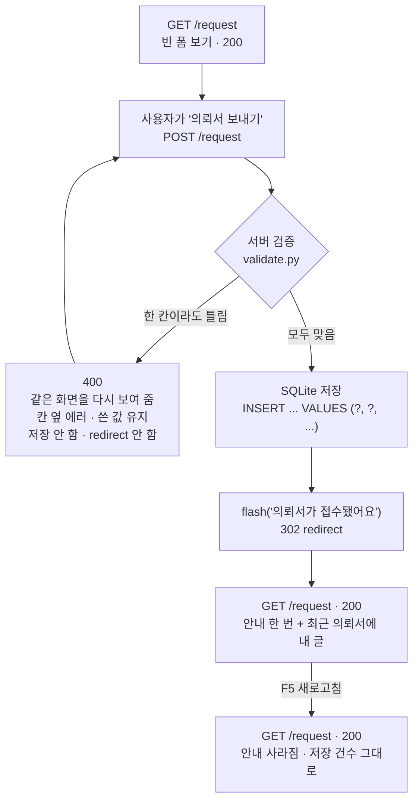
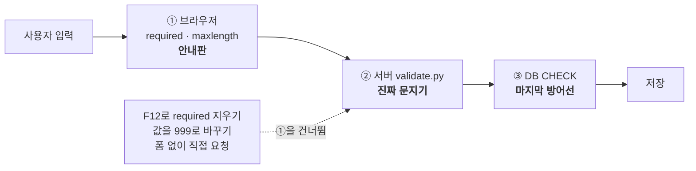
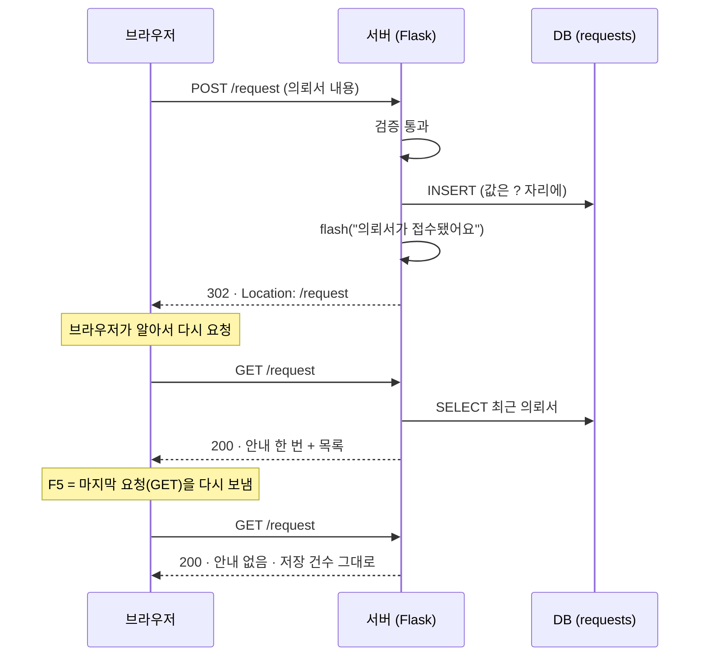

# 검증 · PRG 구조 — ④ 의뢰서 (담당: 팀원 B)

의뢰서 남기기(`/request`)가 **POST → 검증 → 저장 → PRG** 순서로 어떻게 움직이는지 그린 문서예요. DB 표는 `DB_구조.md`에 있어요.

## 한눈에 보기



| 파일 | 맡은 일 |
|---|---|
| `templates/request.html` | 폼(`method="post"`), 칸별 에러 문구, 쓴 값 다시 채우기 |
| `validate.py` | 서버 검증 규칙 전부 |
| `pages/request_form.py` | 검증 부르기 → 저장 → redirect + flash |
| `db.py`의 `requests` 표 | 마지막 방어선 (`NOT NULL` · `CHECK`) |

---

## 1. POST — 왜 POST로 받나

| | GET (엽서) | POST (봉투) |
|---|---|---|
| 값이 보이는 곳 | 주소창 (`?region=마포구`) | 요청 본문 (주소창에 안 보임) |
| 쓰는 곳 | 보기만 하는 일 — 매물 필터 | **값을 바꾸는 일 — 의뢰서 저장** |
| 링크 클릭 · 검색 로봇 | 그대로 실행됨 | 실행되지 않음 |

의뢰서는 DB에 한 줄을 **추가**하는 일이라 POST로만 저장해요. `/request`를 주소창에 쳐서 들어가면(GET) 폼만 보이고 아무것도 저장되지 않아요.

---

## 2. 검증 — 세 겹으로 막아요



- **① 브라우저 검사는 안내판이에요.** F12로 `required`를 지우거나 값을 바꿔 보내면 그냥 통과해요.
- **② 서버 검증이 진짜 문지기예요.** 어떤 방법으로 보내든 반드시 여기를 지나요.
- **③ DB 규칙은 마지막 방어선이에요.** 서버 코드에 실수가 있어도 이상한 값은 저장되지 않아요.

### 검증 규칙표

| 칸 | 규칙 | 틀렸을 때 문구 |
|---|---|---|
| 닉네임 `nickname` | 앞뒤 공백을 뗀 뒤 1~20자 | 닉네임은 1~20자로 써 주세요. |
| | 전화번호 모양이면 거절 | 전화번호는 받지 않아요. 닉네임만 써 주세요. |
| 희망 지역 `region` | 앞뒤 공백을 뗀 뒤 1~20자 | 희망 지역은 1~20자로 써 주세요. (예: 마포구) |
| 예산 `budget` | 숫자만 (`0`~`9`) | 예산은 숫자만 써 주세요. (예: 20000) |
| | 1 ~ 1,000,000 (만원) | 예산은 1만원부터 1,000,000만원(100억)까지 쓸 수 있어요. |
| 방 수 `rooms` | `1` `2` `3` `4` `5` 중 하나 | 방 수는 1~5 중에서 골라 주세요. |
| 요청 내용 `message` | 앞뒤 공백을 뗀 뒤 1~200자 | 요청 내용은 1~200자로 써 주세요. (지금 N자) |
| | 전화번호 모양이면 거절 | 전화번호는 받지 않아요. 지우고 다시 남겨 주세요. |

- 공백만 넣은 칸은 빈칸으로 봐요.
- 고르는 칸(방 수)도 **정해진 값 중 하나인지** 서버가 확인해요. F12로 `999`를 보내도 막혀요.
- 실명 · 전화번호 · 이메일을 받는 칸은 없어요.

### 검증에 실패하면

```
POST /request  (예산 = "이억")
        │
        ▼
   validate.py  →  errors = {"budget": "예산은 숫자만 써 주세요. (예: 20000)"}
        │
        ▼
   400 Bad Request  ·  같은 request.html 을 다시 그림
        ├─ 맨 위:  "1곳을 다시 확인해 주세요. 쓴 내용은 그대로 있어요."
        ├─ 예산 칸: 빨간 테두리 + 칸 아래 문구
        ├─ 다른 칸: 내가 쓴 값 그대로 (values 로 다시 채움)
        └─ DB:     아무것도 저장하지 않음
```

실패했을 때 **redirect 하지 않는 이유**: redirect 하면 새 요청이 되어서 사용자가 쓴 값과 에러 문구가 사라져요. 그래서 400과 함께 그 자리에서 같은 화면을 다시 보여 줘요.

---

## 3. PRG — Post → Redirect → Get

저장에 성공하면 화면을 바로 그리지 않고, **다른 주소로 보낸 뒤(redirect)** 거기서 화면을 그려요.



### PRG가 없으면 생기는 일

| | PRG 없음 (POST 응답으로 바로 화면) | PRG 있음 |
|---|---|---|
| 브라우저가 기억하는 마지막 요청 | POST | GET |
| F5를 누르면 | "양식을 다시 제출할까요?" → 같은 의뢰서가 **또 저장됨** | 화면만 다시 그림 |
| 뒤로 가기 · 주소 복사 | 꼬임 | 정상 |

### flash — 안내를 한 번만

- `flash("의뢰서가 접수됐어요")`는 문구를 **세션에 잠깐 넣어 두는** 거예요.
- redirect 뒤 첫 화면에서 꺼내 보여 주고, 꺼내는 순간 지워져요. 그래서 새로고침하면 사라져요.
- 세션을 쓰기 때문에 `SECRET_KEY`가 필요해요.

---

## 4. 상태 코드 정리

| 상황 | 상태 코드 | F12 Network 에서 |
|---|---|---|
| 폼 열기 | 200 | `request` 200 |
| 잘못 넣고 보내기 | **400** | `request` 400 |
| 제대로 넣고 보내기 | **302** → 200 | `request` 302, 이어서 `request` 200 |
| 새로고침 | 200 | `request` 200 (POST 아님) |

---

## 5. 직접 확인하는 법 (공격 표)

`/request`에서 F12 → Network 탭을 열어 두고 해 보세요.

| # | 해 볼 것 | 기대 |
|---|---|---|
| 1 | 닉네임 비우고 보내기 | 400 · 칸 옆 에러 · 다른 칸은 그대로 |
| 2 | 닉네임에 공백만 | 400 |
| 3 | 닉네임 21자 · 요청 201자 (F12로 `maxlength` 지우기) | 400 |
| 4 | 예산에 `이억` · `-5` · `0` | 400 |
| 5 | F12로 방 수 값을 `999` · `둘`로 바꾸기 | 400 |
| 6 | F12로 `required`를 지우고 요청 내용 비우기 | 400 |
| 7 | 요청 내용에 `010-1234-5678` | 400 |
| 8 | 요청 내용에 `<script>alert(1)</script>` | 저장됨 · 창이 뜨지 않고 글자 그대로 보임 |
| 9 | 요청 내용에 `It's ok'); DROP TABLE requests; --` | 글자 그대로 저장 · 표는 그대로 |
| 10 | 제대로 남긴 뒤 F5 두 번 | 302 → 200 · 안내 한 번만 · 1건만 저장 |

자동 테스트로도 같은 내용을 확인해요: `python -m pytest -q` (`tests/test_request_form.py`).
